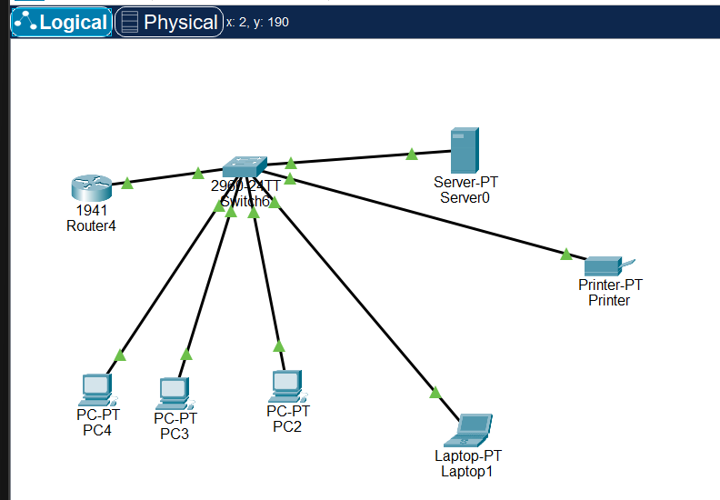

# SME Network with Cisco Packet Tracer

Simulation of a small business network: one router, one switch, three PCs, one laptop, one server and one printer, all on the same local network.

## Objective
Build, configure and test a local network with static IPv4 addressing, and verify communication between all devices.

## Topology

Devices:
- 1 Cisco 1941 router (R1)
- 1 Cisco 2960-24TT switch
- 3 PCs (PC2, PC3, PC4) and 1 laptop (Laptop1)
- 1 server (Server0) and 1 printer (Printer)

Cabling: copper straight-through Ethernet cables between the switch and each device.

## Addressing Plan
Network: 192.168.10.0/24 (subnet mask 255.255.255.0)
Default gateway: 192.168.10.1

- R1 (G0/0): 192.168.10.1
- Server0: 192.168.10.10
- Printer: 192.168.10.20
- PC2: 192.168.10.101
- PC3: 192.168.10.102
- PC4: 192.168.10.103
- Laptop1: 192.168.10.104

## Router Configuration
    enable
    configure terminal
    hostname R1
    interface g0/0
    ip address 192.168.10.1 255.255.255.0
    no shutdown
    end
    copy running-config startup-config

Full configuration: [R1-config.txt](R1-config.txt)

## Tests
From PC2, pings to the router, the server, the printer and the laptop all succeed (4 packets sent, 4 received, 0% loss).

## What I Learned
- [Write 3 or 4 points in your own words]

## Planned Improvements
- DHCP for the PCs and the laptop
- A second subnet
- DNS service on the server
